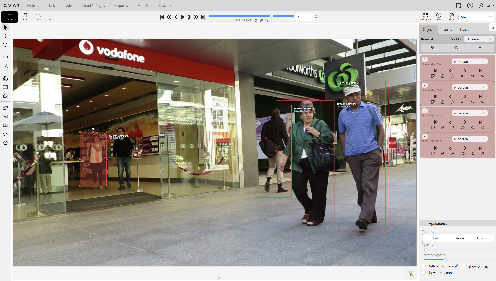
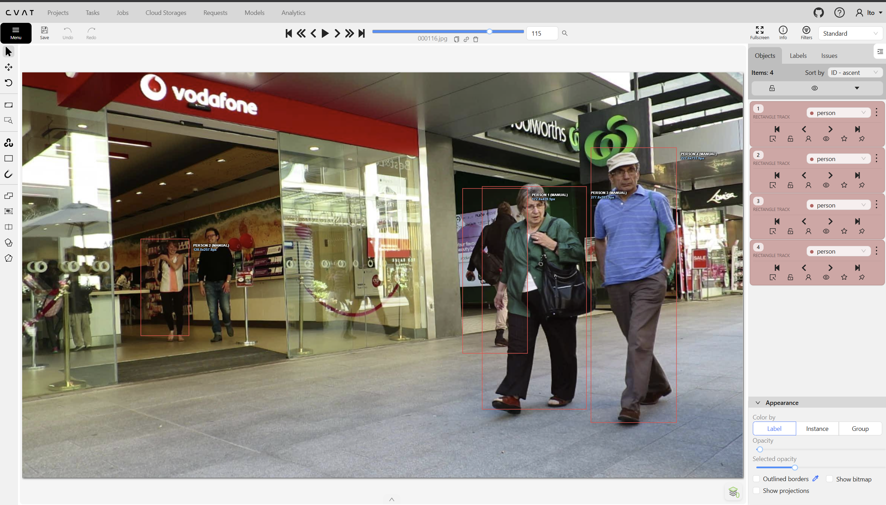
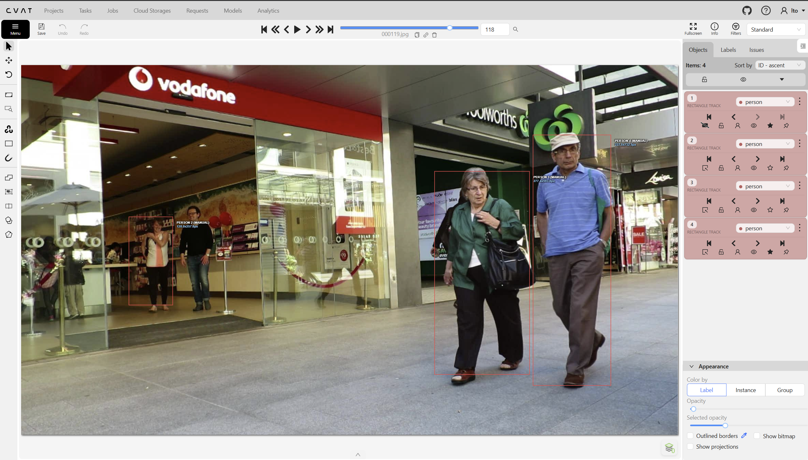

# Báo cáo cá nhân — PhamHuuMinh-2A202603330

Đoạn video: MOT17-09, 150 frame (frame 1–150), nguồn MOTChallenge, giấy phép CC BY-NC-SA 3.0.

## 0. Thông tin học viên

- Họ tên: Pham Huu Minh
- MSSV: 2A202603330
- Mã đề (A/B/C): A
- Link repository: https://github.com/lto7777777/K5-L2B-PHAMHUUMINH-2A202603330-MOTTracking
- Giờ bắt đầu: 16:46 (13/11/2026, GMT+7)
- Giờ kết thúc: 20:24 (13/11/2026, GMT+7)

## 1. Xem trước đoạn video (CP0)

5 người của đề A = MOT id 1, 7, 19, 20, 21 → P1–P5. Frame theo CVAT (0–149).

| Mã | Frame xuất hiện | Frame cuối thấy được | Rẽ / dừng / đổi tốc độ ở frame | Bị che ở frame | Ghi chú |
|---|---|---|---|---|---|
| P1 | 0 | 117 | đổi hướng và tốc độ nhiều, keyframe dày | rời khung ở 117 | người theo dõi chính cho đoạn che |
| P2 | 69 | 149 | đi thẳng đều | — | vào từ mép trái ở frame 69 |
| P3 | 0 | 149 | đổi hướng quanh 23–36 | — | theo suốt 150 frame |
| P4 | 40 | 149 | vào từ mép phải, đi đều | — | box lớn, ở gần camera |
| P5 | 0 | 108 | đi đều | — | rời khung sau frame 108 |

## 2. Keyframe và thời gian (CP1, CP4)

Số keyframe lấy từ kết quả `src/check_submission.py` (file CVAT for video 1.1).

| Mã | Số keyframe | Số frame có mặt | Keyframe / 100 frame | Thời gian (phút) | Chỗ khó |
|---|---:|---:|---:|---:|---|
| P1 | 52 | 118 | 44,1 | 10 | đổi hướng nhiều, theo tới khi rời khung |
| P2 | 5 | 81 | 6,2 | 3 | đi thẳng đều, ít keyframe |
| P3 | 27 | 150 | 18,0 | 7 | theo suốt, có cụm đông quanh 21–25 |
| P4 | 29 | 110 | 26,4 | 6 | box lớn, đi đều từ mép phải |
| P5 | 6 | 109 | 5,5 | 4 | đi đều, rời khung sau 108 |
| **Tổng** | **119** | **568** | **21,0** | **~30** | |

Keyframe / 100 frame của cả bài = 119 ÷ 568 × 100 = **21,0**.

Thời gian làm khoảng 30 phút thao tác thực trên job. Cột thời gian từng người là ước lượng theo số keyframe và độ khó.

Đặt keyframe nhiều nhất ở **P1** (52 keyframe). P1 đổi hướng và tốc độ nhiều nhất, nên nội suy tuyến tính sai ở mỗi chỗ rẽ và phải thêm keyframe để box bám đúng. P2 ngược lại chỉ cần 5 keyframe vì đi gần như thẳng đều, nội suy giữa hai đầu đã đúng.

## 3. Đoạn bị che (CP2)

Người theo dõi chính: **P1**.

P1 được gán bằng track mode liên tục từ frame 0 tới frame 117. Trong đoạn này P1 có lúc bị người và vật ở gần che một phần; khi đó box vẫn giữ ở vị trí ước lượng toàn thân (amodal box), không co theo phần nhìn thấy, đúng quy ước mục 2 của `docs/GUIDELINE.md`. Đến frame 117 P1 đi ra khỏi khung hình, nên từ frame 118 bật `outside` và kết thúc track tại đó.

| Mốc | Frame |
|---|---:|
| Theo dõi liên tục từ | 0 |
| Frame cuối còn thấy trong khung | 117 |
| Bật `outside` (rời khung) | 118 |

- Quyết định: P1 rời hẳn khỏi khung ở frame 117, không quay lại trong phần còn lại của đoạn (118–149), nên **kết thúc track, không mở ID mới**. Theo ngưỡng 60 frame: chỉ giữ cùng ID khi người khuất rồi hiện lại trong vòng 60 frame; ở đây P1 không xuất hiện lại nên để track kết thúc là đúng.
- Lý do dùng `outside` thay vì xóa box: nhãn phải nói rõ đây là P1 đã rời khung chứ không phải biến mất, để tracker không hiểu nhầm thành một người mới và không bị chấm sai ở phần ReID.

Ảnh chụp màn hình (đoạn quanh frame 110–118, P1 trước khi rời khung và lúc bật `outside`):





## 4. Tự review ID (CP3)

Duyệt hai lượt: lượt 1 theo từng người (đi ngược từ frame 149 về 0), lượt 2 theo cảnh (nhảy 10 frame, nhìn cả 5 box mỗi màn). Chú ý các chỗ hai người đi sát hoặc cắt nhau, là nơi dễ đổi ID nhất.

| Frame | Mã người | Loại lỗi | Mô tả một câu | Phát hiện ở lượt | Đã sửa? |
|---:|---|---|---|---|---|
| 21–25 | P1, P3 | ok | cụm đông, nhiều người đi sát; kiểm lại ID bám đúng từng người | 2 | — |
| 70 | P3, P4, P5 | ok | nhiều người giao nhau, kiểm từng ID không nhảy người | 2 | — |
| 98–99 | P4 | ok | một người khác rời khung gần P4, P4 (box lớn) vẫn đi tiếp đúng người | 2 | — |
| 108 | P5 | ok | P5 rời khung sau 108, kết thúc track đúng chỗ, không bỏ sót | 1 | — |
| 117 | P1 | ok | P1 rời khung ở 117, track kết thúc đúng chỗ | 1 | — |

Tổng hợp số lỗi theo loại:

| `id_switch` | `fragmentation` | `lost` | `merge` | `false_track` | `drift` | `flag` |
|---:|---:|---:|---:|---:|---:|---:|
| 0 | 0 | 0 | 0 | 0 | 0 | 0 |

Đã kiểm hai lượt, không còn lỗi ID. Các chỗ hai người đi sát (21–25, 70) là nơi lượt 2 theo cảnh giúp nhiều hơn lượt 1: nhìn từng người thấy track vẫn liền, chỉ khi nhìn cả cảnh mới chắc hai ID không hoán đổi cho nhau.

## 5. File xuất và kết quả tự kiểm (CP4)

| Kiểm tra | Kết quả |
|---|---|
| Tên file MOT 1.1 | `src/exports/PhamHuuMinh_mot.zip` |
| Tên file CVAT for video 1.1 | `src/exports/PhamHuuMinh_cvat_video.zip` |
| Số track ID khác nhau trong `gt/gt.txt` (phải là 5) | 5 |
| Frame `outside` không có dòng trong `gt.txt` | đúng (frame sau khi track kết thúc không có dòng) |
| Job đã completed trên CVAT máy cá nhân | rồi |

Phần tóm tắt in ra từ `src/check_submission.py`:

```text
=== File MOT 1.1: PhamHuuMinh_mot.zip ===
  Số track ID: 5   |   Tổng số box: 568

  Track | Frame có mặt | Số frame | Đoạn vắng (outside)
      1 |   0–117      |      118 | -
      2 |   0–149      |      150 | -
      3 |   0–108      |      109 | -
      4 |  40–149      |      110 | -
      5 |  69–149      |       81 | -

  [CẢNH BÁO]  Track 1: chiều cao box đổi > 30% trong 1 frame ở frame [44, 109].
  [CẢNH BÁO]  Track 2: chiều cao box đổi > 30% trong 1 frame ở frame [99, 149].
  [CẢNH BÁO]  Track 5: chiều cao box đổi > 30% trong 1 frame ở frame [149].

=== File CVAT for video 1.1: PhamHuuMinh_cvat_video.zip ===
  Tổng: 119 keyframe / 568 frame có mặt = 21.0 keyframe / 100 frame
  [OK]        Đọc được 5 track từ annotations.xml.

=== Tóm tắt ===
  Lỗi: 0   |   Cảnh báo: 3
```

Cả 3 cảnh báo cùng một loại "chiều cao box đổi > 30% trong 1 frame", không phải lỗi định dạng. Theo từng người: P1 (track 1 trong file MOT) ở frame 44 và 109; P3 (track 2) ở frame 99 và 149; P2 (track 5) ở frame 149. Frame 149 là frame cuối của đoạn, và 109 nằm ngay trước lúc P1 rời khung ở 117, nên box ước lượng toàn thân đổi kích thước nhanh ở các mốc này là bình thường. Đã mở lại từng frame cảnh báo trong CVAT: tất cả đều là box đổi theo ước lượng toàn thân (amodal) khi người đổi khoảng cách tới camera, không phải lỗi co box theo phần nhìn thấy, nên giữ nguyên.

Số thứ tự track_id trong file MOT do CVAT đánh khi xuất, không trùng thứ tự P1–P5; việc chấm so khớp theo IoU với ground truth nên không phụ thuộc số thứ tự này.

## 6. Ba câu kết

1. **Nếu được gán lại, đặt keyframe khác ở đâu?**

   Ở P1 (52 keyframe) có thể bớt vài keyframe ở đoạn đi thẳng đều giữa hai khúc rẽ, vì ở đó nội suy tuyến tính đã đúng nên keyframe thừa chỉ làm box rung nhẹ. Đổi lại nên giữ keyframe dày ở các khúc rẽ và chỗ đổi kích thước. Nguyên tắc chung rút ra: ít keyframe ở đoạn vận tốc không đổi, nhiều keyframe ở chỗ đổi hướng, đổi tốc độ hoặc đổi kích thước box.

2. **Có chỗ nào không chắc "cùng ID hay ID mới"?**

   Chỗ phải cân nhắc là khi P1 rời khung ở frame 117 và P5 ở frame 108. Câu hỏi là người đó đi hẳn hay chỉ khuất tạm rồi quay lại. Áp ngưỡng 60 frame: cả hai không xuất hiện lại trong 60 frame sau đó nên để track kết thúc, không mở ID mới. Nếu có người khuất rồi hiện lại trong 60 frame và đúng hướng, tốc độ, ngoại hình thì mới giữ cùng ID bằng cách tắt `outside` và nối tiếp track.

3. **Một lỗi ID ảnh hưởng xe tự lái và MOTA/IDF1 thế nào?**

   Nếu một ID nhảy sang người đi sát rồi nhảy lại, hệ thống sẽ thấy "một người" dịch chuyển đột ngột ngang vài chục pixel trong một frame, làm vận tốc tính từ nhãn nhảy vọt (hơn 100 km/h), khiến mô-đun dự đoán quỹ đạo của xe tự lái ước lượng sai hướng đi và có thể phanh hoặc bẻ lái nhầm. Về điểm số, một lần hoán ID như vậy làm hỏng **IDF1** nhiều hơn **MOTA**: MOTA chỉ cộng vài IDSW trên tổng số frame nên giảm ít, còn IDF1 đo tính nhất quán danh tính theo cả track nên một lần đổi ID kéo điểm xuống mạnh ở cả hai người liên quan.

## Bonus (nếu làm)

Không làm bonus.

## 7. Tài liệu tham khảo và công cụ AI đã dùng

Tài liệu:

- `docs/GUIDELINE.md`, `docs/CVAT_CHEATSHEET.md`, `docs/MOT_FORMAT.md`, `CHECKPOINTS.md`, `RUBRIC.md` của repo đề bài.
- Milan, A. và cộng sự (2016), *MOT16: A Benchmark for Multi-Object Tracking* — nguồn dữ liệu MOT17-09.

Công cụ AI: Claude.
